# HAKOBI 操作マニュアル

生産工程管理・実画面版　作業者・編集者向け。2026年11月20日改訂。v121対応。

画面例は説明用データを使っています。

## 目次

### はじめに（共通）

- [アプリを開く](#login)
- [作業者と編集者が使う画面](#roles)

### 工程と配布（共通）

- [工程一覧を読む](#ledger)
- [案件を探して並び替える](#filters)
- [一覧の文字と表示量を変える](#zoom)
- [工程の担当と状態を更新する](#process)
- [全工程へまとめて入力する](#bulk)
- [最終仕上げを完了する](#final-finish)
- [配布担当と配布表を管理する](#distribution)
- [保存失敗と未保存入力に対応する](#errors)
- [端末の表示モードを設定する](#theme)

### 注文とラベル（編集者）

- [概況で優先する案件を見る](#dashboard)
- [案件を追加して注文情報を直す](#order)
- [注文書や本文を取り込む](#import)
- [読取結果を確認して案件へ反映する](#intake)
- [製品の修正を次回にも使う](#learning)
- [製品ラベルを印刷する](#labels)

### 研磨と出荷（編集者）

- [研磨へ発送して戻りを記録する](#polishing)
- [研磨の戻りや発送を取り消す](#polishing-correction)
- [研磨の発送日と戻り日を直す](#polishing-date)
- [研磨区分と自由設定単価を選ぶ](#polishing-class)
- [月別の研磨代を確認する](#billing)
- [出荷完了と再開を記録する](#completed)

### 碓井材料在庫（編集者）

- [材料の在庫を確認して発注する](#materials)
- [材料の入庫・発注の変更を記録する](#material-receive)
- [材料の棚卸差と備考を記録する](#material-adjust)
- [碓井材料を使わない製品を登録する](#material-exclusions)

### Tezoe製品在庫（編集者）

- [Tezoe製品の在庫と見込を読む](#stock-overview)
- [Tezoe製品の備考を編集する](#stock-note)
- [Tezoeの新製品・特注品を在庫に追加する](#stock-custom)
- [受注の出荷予定を決める](#stock-schedule)
- [製造総数と在庫補充分を入力する](#stock-plan)
- [完成品をロットで入庫する](#stock-receive)
- [在庫から実際の出荷を記録する](#stock-ship)
- [全数を在庫で納める受注を完了する](#stock-only)
- [製品在庫の記録を取り消す](#stock-reverse)

### 困ったとき（共通）

- [困ったときの確認と終業時の点検](#help)

## アプリを開く

作業者・編集者

登録済みのGoogleアカウントで開きます。読み込みが終わると、最初に「工程一覧」が表示されます。

**HAKOBIの利用URL または ホーム画面のアイコン**

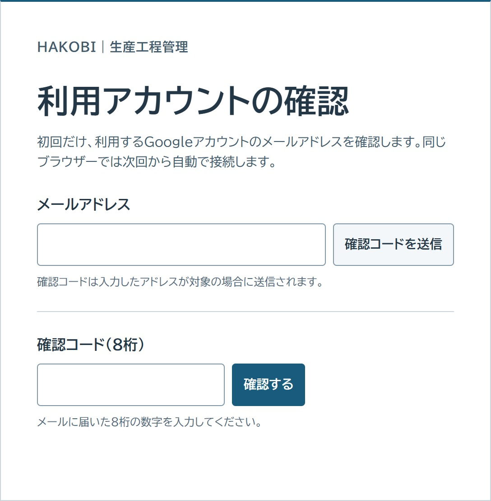

1. **登録したGoogleアカウントを選ぶ**
   ログインを求められたら、管理者に伝えたアカウントを選びます。

2. **必要に応じてメールで本人確認する**
   確認画面が出たらメールアドレスを入力し、「確認コードを送信」を押します。現在の画面では、メールに届いたコードを「確認コード」欄へ貼り付けて「確認する」を押します。

3. **ホーム画面から開けるようにする**
   iPadはSafariの「共有」→「ホーム画面に追加」。AndroidはChromeの「⋮」→「インストールしてショートカットを作成」→「ショートカットを作成」→「追加」です。Chromeによって「ホーム画面に追加」と表示されます。

**認証や読み込みで止まったとき**

確認コードは24時間以内に1回だけ使えます。受信済みの有効なコードがある場合は、そのメールを使います。メールが見当たらなければ、迷惑メールと利用登録を確認します。同じブラウザーでは端末認証の発行から90日間、自動で接続できます。起動画面に再試行が出た場合は、接続を確認して再試行します。

[HAKOBIを開く](https://script.google.com/macros/s/AKfycbwVlF96mdaxEptRwXWeh2oAZ0-s0INe6jMHaB1BWhImXd8x_hbn7hSKcpMY7v2ERzJmpA/exec)

[作業者と編集者が使う画面](#roles)　[端末の表示モードを設定する](#theme)

## 作業者と編集者が使う画面

作業者・編集者

アプリの権限名では、作業者は「作業員」と表示されます。

- **作業者**  工程一覧で担当と状態を更新します。担当・配布表で担当の割り振りと印刷を行い、完成品リストで出荷待ちと出荷済みを確認します。

- **編集者**  共通の操作に加え、概況から案件を確認し、注文・取込・ラベル・研磨・在庫・出荷の記録を扱います。

**使う画面が見つからない場合**

上部のタブを横にスクロールするか、狭い画面では画面メニューから探します。登録したGoogleアカウントと権限も確認してください。

[工程一覧を読む](#ledger)　[概況で優先する案件を見る（編集者）](#dashboard)

## 工程一覧を読む

作業者・編集者

1製品が1行です。ケリソンパンチ、鋭匙鉗子、分類未確定の「その他」の順に並びます。

**工程一覧**

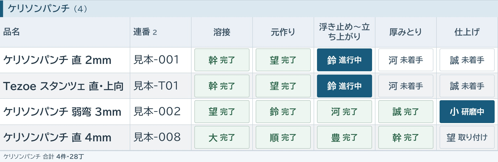

1. **品名・連番で製品を見分ける**
   品名を押すと「案件の詳細」が開きます。横にスクロールしても連番を確認できます。

2. **担当と状態を確認する**
   工程欄は担当名と状態を表示します。鋭匙鉗子は「頭付け・幅取り」、ケリソンパンチは「厚みとり」です。

3. **件数と数量を見る**
   各分類の下に小計があり、その下に表示中の総合計が出ます。更新するには、対象行の工程欄を押します。

4. **備考を確認する**
   「33製品」表示の右端に「備考」があります。備考を押すと「案件の詳細」が開きます。

**全長欄の読み方**

ユフ・松井（TMマツイ）・TSメディカルでは製品番号が表示され、番号未登録は「—」です。注文上の全長は詳細画面で確認します。

[案件を探して並び替える](#filters)　[工程の担当と状態を更新する](#process)

## 案件を探して並び替える

作業者・編集者

検索や並び順は、工程一覧と完成品リストでそれぞれ設定できます。

**工程一覧 または 完成品リスト → 検索・絞り込み・並び順**

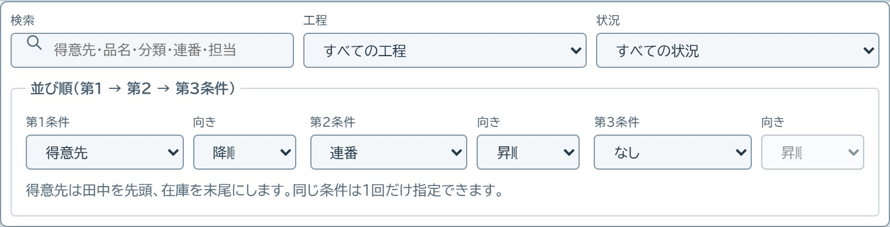

1. **検索語や条件を入れる**
   得意先・品名・連番・担当などで検索します。必要に応じて「工程」「状況」を選びます。

2. **第1～第3条件で並べ替える**
   項目と昇順・降順を選びます。第1条件を「得意先」、第2条件を「品名」にすると、同じ得意先の製品が品名順に並びます。

3. **出荷済みは年月を指定する**
   完成品リストの出荷済みは「出荷年」「出荷月」で絞れます。

**初期順と選択の保存**

分類ごとに田中が先頭、ほかの得意先は逆順、在庫・在庫用は末尾です。選んだ並び順は一覧ごとにこの端末へ保存されます。

[工程一覧を読む](#ledger)　[一覧の文字と表示量を変える](#zoom)

## 一覧の文字と表示量を変える

作業者・編集者

表示を変えるボタンと倍率欄は、一覧の上にあります。

**工程一覧 または 完成品リスト → 一覧の表示倍率**

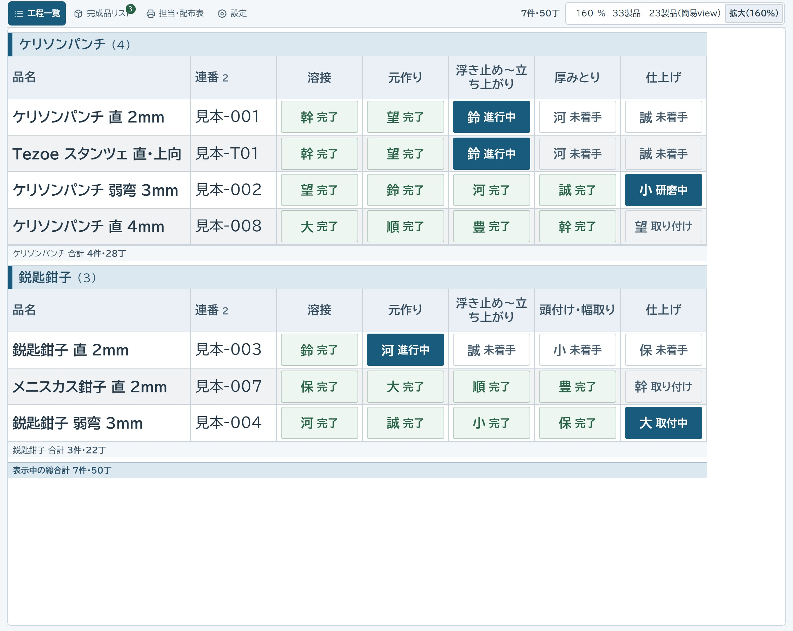

1. **33製品・23製品から選ぶ**
   「33製品」は通常表示です。「23製品（簡易view）」では行が大きくなり、備考以降が省略されます。

2. **工程だけを大きく見る**
   「拡大（160%）」で品名・連番・5工程を表示します。「33製品」か「23製品（簡易view）」で列が戻ります。

3. **倍率を手動で調整する**
   40～160%を入力するか、2本指ピンチ、Ctrlキー（Macは⌘）＋ホイールを使います。倍率欄の上ではホイールだけで調整できます。

**設定はこの端末へ保存**

一覧の倍率だけが変わります。1本指や通常のホイールはスクロールに使います。表が画面幅を超える場合は横にスクロールできます。

[工程一覧を読む](#ledger)　[端末の表示モードを設定する](#theme)

## 工程の担当と状態を更新する

作業者・編集者

対象行の工程欄を押し、開いた画面で品名・連番・数量を照合します。

**工程一覧 → 対象行の工程欄**

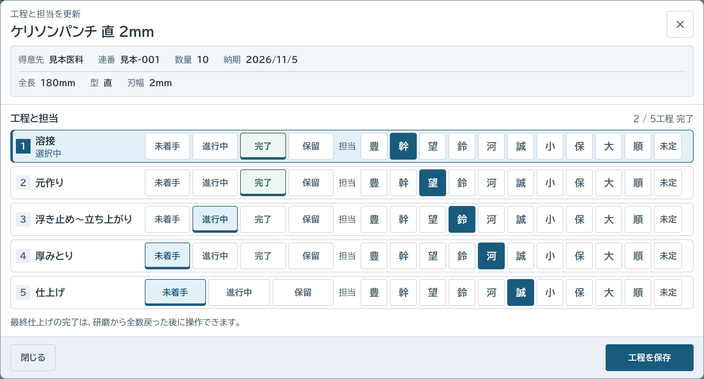

1. **対象工程の状態を選ぶ**
   実際の作業に合わせて状態のボタンを押します。

2. **担当を選ぶ**
   同じ工程の担当者名を押します。担当を外すときは「未定」を選びます。

3. **「工程を保存」を押す**
   一覧に戻った後も保存は続きます。結果が表示されてから、同じ案件を再編集できます。

**入力を変えてから閉じた場合**

「編集を続ける」「保存して閉じる」「変更を破棄して閉じる」から選びます。

[全工程へまとめて入力する](#bulk)　[保存失敗と未保存入力に対応する](#errors)

## 全工程へまとめて入力する

作業者・編集者

同じ案件の5工程へ同じ状態、または同じ担当をまとめて入力できます。

**工程一覧 → 対象行の工程欄**

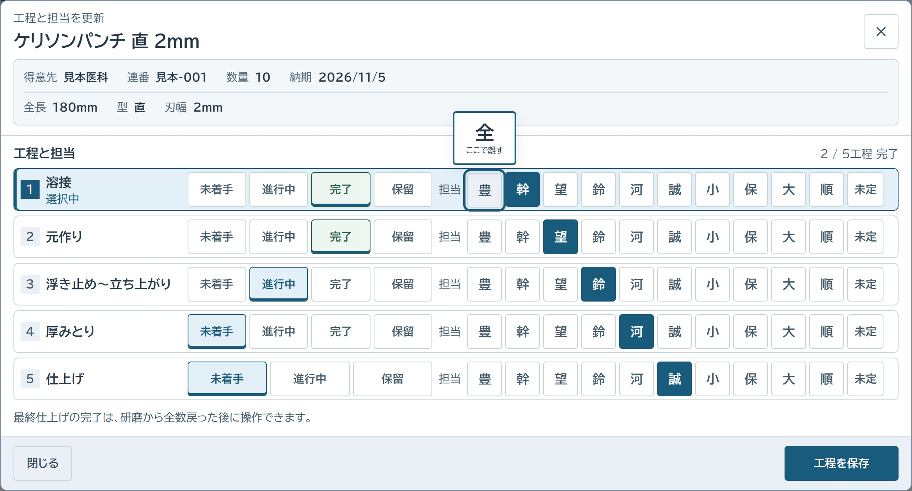

1. **担当か状態を長押しする**
   上に「全」が出るまで押し続けます。

2. **「全」まで動かして離す**
   変更を確認します。「直前の一括変更を戻す」で最後の1回を取り消せます。キーボードでは対象ボタンに移動してAlt＋↑を押します。

3. **「工程を保存」を押す**
   5工程それぞれの担当と状態を確かめてから保存します。

**一括の担当と完了条件**

全工程で候補に表示される人を一括で選べます。最終仕上げの完了には、研磨への全数発送と全数戻りが必要です。

[工程の担当と状態を更新する](#process)　[最終仕上げを完了する](#final-finish)

## 最終仕上げを完了する

作業者・編集者

仕上げ欄の「取り付け」は、研磨から全数戻り、最終仕上げが未着手の状態です。

**工程一覧 → 対象行の仕上げ欄**

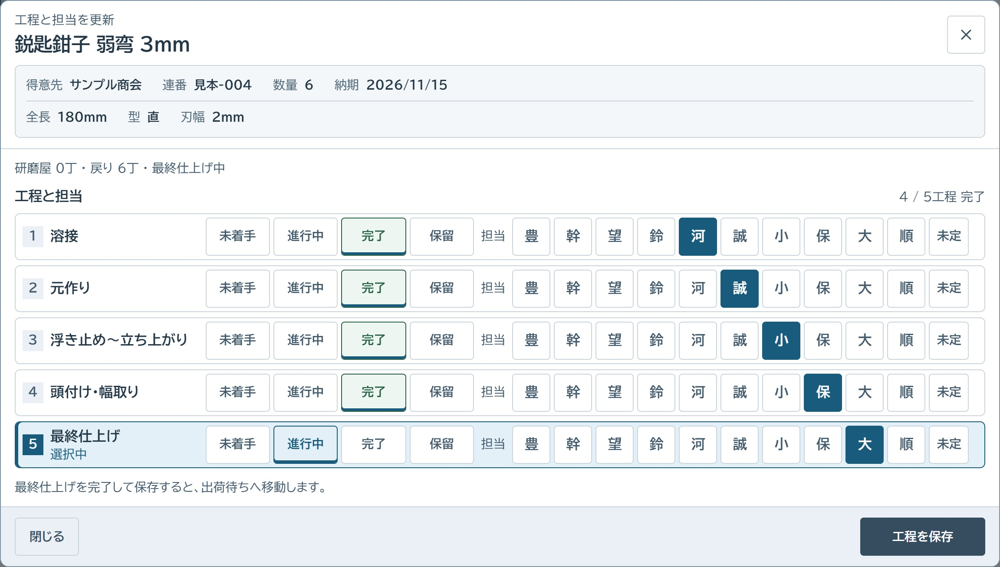

1. **研磨の全数戻りを確かめる**
   工程一覧の「研磨中」は返却待ちです。記録が現物と違うときは、編集者が研磨管理表で履歴を確認します。

2. **最終仕上げが終わったら「完了」を選ぶ**
   対象行の仕上げ欄を押します。研磨への全数発送・全数戻りが済むと、「最終仕上げ」で「完了」を選べます。

3. **「工程を保存」を押す**
   一覧に戻ったら、「完成品リスト」の上段「出荷待ち」に移ったことを確認します。下段の「出荷済み」で出荷状況を確認できます。

**仕上げ欄の表示**

戻り後は「取り付け」「取付中」「取付保留」で状態を確認できます。先行4工程が未完了でも、最終仕上げは完了できます。

[工程一覧を読む](#ledger)　[出荷完了と再開を記録する（編集者）](#completed)

## 配布担当と配布表を管理する

作業者・編集者

鋭匙鉗子の配布担当を案件ごとに1人選びます。工程の担当は工程画面で確認します。

**担当・配布表**

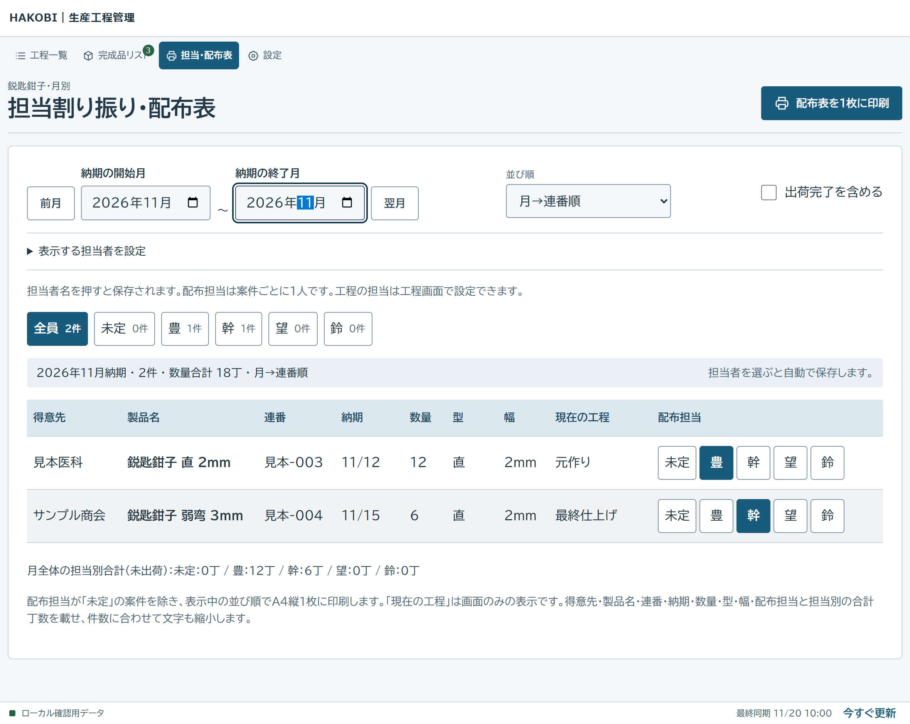

1. **納期の開始月と終了月を指定する**
   担当者で絞り込めます。出荷済みも見る場合は「出荷完了を含める」を選びます。

2. **並び順を選ぶ**
   「月→得意先→納期順」「月→納期順」「月→連番順」から選びます。連番順では各月の連番が並び、空欄は末尾になります。

3. **行の担当名を押す**
   担当名を選ぶとその場で保存されます。「未定」で担当を外せます。納期がある案件が月別の表に出ます。

4. **「配布表を1枚に印刷」を押す**
   担当が決まった表示行を、画面と同じ順でA4縦1枚に印刷します。倍率100%、ヘッダーとフッターはオフにします。

**担当別の合計丁数**

画面の合計は選択期間の全担当、印刷の合計は印刷対象の担当分です。「現在の工程」は画面で確認できます。

[案件を探して並び替える](#filters)　[最終仕上げを完了する](#final-finish)

## 保存失敗と未保存入力に対応する

作業者・編集者

保存に失敗したら、表示された理由と保持されている入力を確認します。

**画面下の保存結果 または 閉じるときの確認**

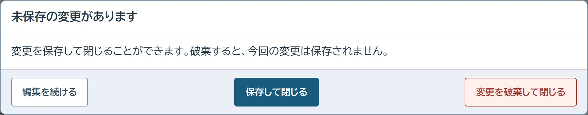

1. **「入力内容を開く」を押す**
   保存エラーから保持された入力を開き、通信の状態を確認します。

2. **内容を確かめて保存し直す**
   「他端末の更新を確認」が出たら、同じ項目の変更ごとに「最新の保存値を使う」か「自分の入力を使う」を選びます。別々の項目は最新の画面に反映されるので、内容を確認して保存します。

3. **入力を変えて閉じるときは操作を選ぶ**
   「編集を続ける」「保存して閉じる」「変更を破棄して閉じる」から選びます。

[工程の担当と状態を更新する](#process)　[困ったときの確認と終業時の点検](#help)

## 端末の表示モードを設定する

作業者・編集者

見やすい表示を、この端末のブラウザーごとに設定できます。

**設定 → 表示モード**

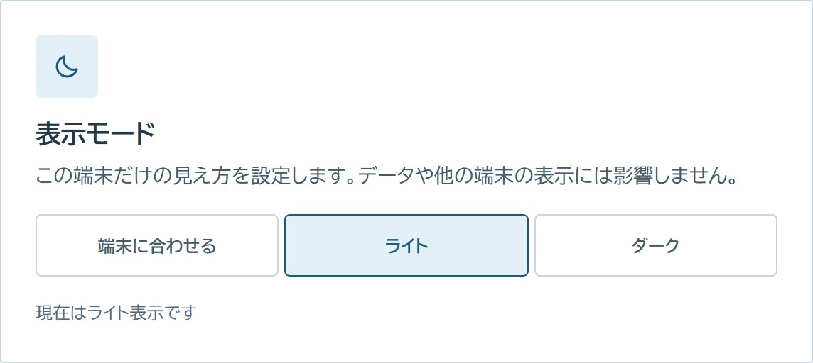

1. **表示モードを選ぶ**
   「端末に合わせる」「ライト」「ダーク」から選びます。

2. **一覧の大きさも調整する**
   一覧の上部で「33製品」「23製品（簡易view）」「拡大（160%）」や手動倍率を選びます。

3. **設定が戻る場合は開き方を確認する**
   iPadのSafariとホーム画面のアプリは別々に保存します。同じブラウザーやアイコンから開きます。

**同じ開き方で設定が戻る場合**

プライベートブラウズやブラウザーのデータ削除を確認します。通常の利用で毎回戻る場合は、端末名と開き方を管理者へ伝えます。

[アプリを開く](#login)　[一覧の文字と表示量を変える](#zoom)

## 概況で優先する案件を見る

編集者

進行中、納期注意、今月完了、出荷待ち、ラベル印刷待ちの件数から作業へ進めます。

**概況**

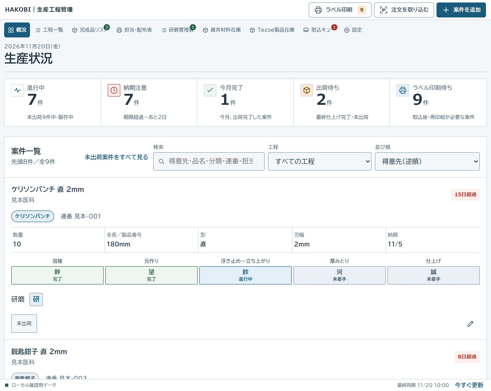

1. **確認したい件数を押す**
   「納期注意」は期限超過からあと2日までの案件です。件数から該当する一覧や印刷画面を開きます。

2. **案件一覧で対象を探す**
   得意先・品名・連番などで検索し、対象の詳細や工程を開きます。

[案件を探して並び替える](#filters)　[製品ラベルを印刷する](#labels)

## 案件を追加して注文情報を直す

編集者

新しい注文は「案件を追加」、訂正は一覧から対象行の注文情報を開きます。

**上部の「案件を追加」 または 一覧の対象行の編集**

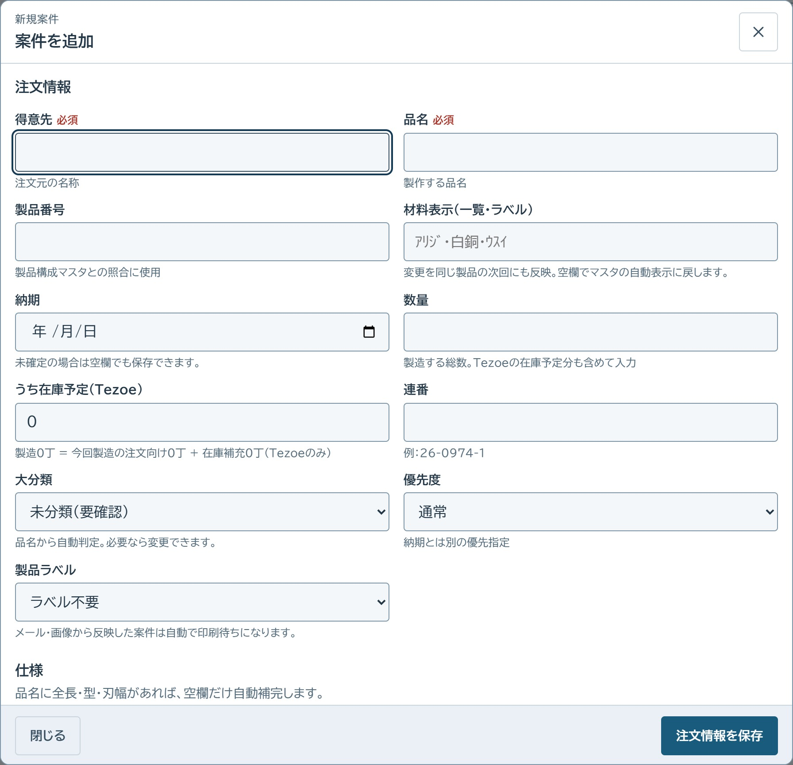

1. **得意先・品名・数量を入力する**
   製品番号・納期・連番・全長・型・刃幅・大分類も原本と照合します。自動で補われた値も確認します。

2. **必要な備考とラベル状態を選ぶ**
   「製品ラベル」で印刷待ちなどを設定します。Tezoeの「数量」は在庫補充分を含む製造総数です。

3. **「注文情報を保存」を押す**
   保存結果を確認します。失敗した場合は、表示されたエラーから入力を開けます。

**訂正する画面の目安**

数量や品名は注文情報、担当と状態は工程画面で直します。研磨や在庫の実績がある案件は、履歴と画面の案内を先に確認します。

[製造総数と在庫補充分を入力する](#stock-plan)　[保存失敗と未保存入力に対応する](#errors)

## 注文書や本文を取り込む

編集者

注文を読み取ると、内容確認へ進みます。原本と照合してから案件へ反映してください。

**注文を取り込む → PDF・画像 または 本文を貼り付け**

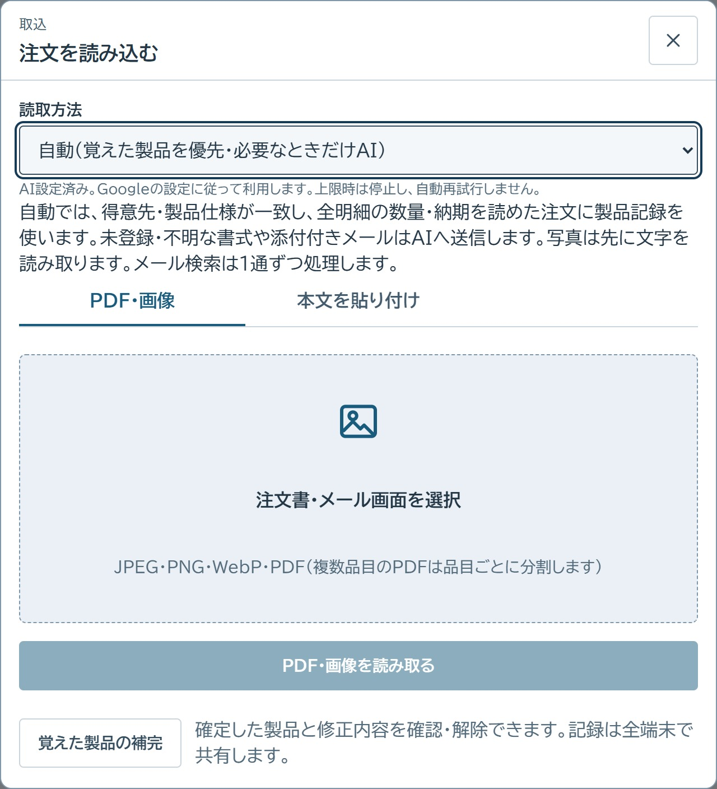

1. **原本を指定する**
   「PDF・画像」ではJPEG・PNG・WebP・PDFを選びます。「本文を貼り付け」では注文メールの本文と、必要に応じて件名を入力します。

2. **読取方法を選ぶ**
   初期選択は「自動（覚えた製品を優先・必要なときだけAI）」です。得意先と製品仕様が一致し、全明細の数量・納期が読める場合は、覚えた製品を使います。

3. **読み取った全品目を確認する**
   「PDF・画像を読み取る」か「本文を読み取る」を押します。自動で条件を満たせない注文は、文書全体をAIで読み取ります。確認画面で原本の明細数・数量・納期を照合します。

**AIを使わずに取り込む場合**

ファイルは「従来の読取（AIを使わない）」、本文は「AIを使わず読み取る」を選びます。

[読取結果を確認して案件へ反映する](#intake)　[製品の修正を次回にも使う](#learning)

## 読取結果を確認して案件へ反映する

編集者

品目ごとの読取結果と原本を比べ、確認できた品目を案件へ反映します。

**取込キュー → 内容を確認する または まとめて確認・編集**

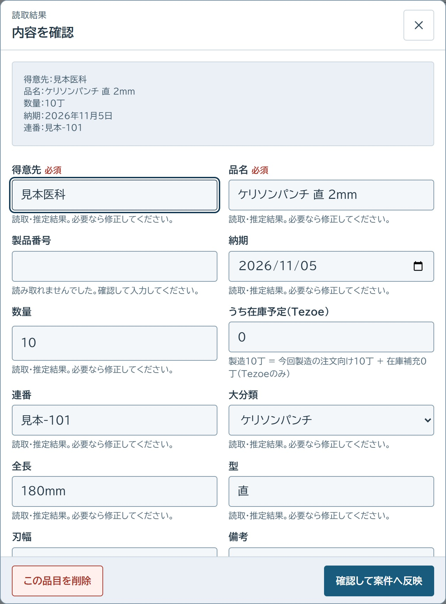

1. **得意先・品名・製品仕様を照合する**
   製品番号・全長・型・刃幅・大分類を確認します。一括画面は「読取元を確認」で読取テキストを開けます。全明細は原本と照合します。

2. **数量・納期・連番を入力する**
   未読取や誤読を直し、重複候補は元の注文と比較します。Tezoeの在庫補充分は「うち在庫予定（Tezoe）」へ入れます。

3. **選んだ品目を案件へ反映する**
   個別は「確認して案件へ反映」。一括は「まとめて確認・編集」で選び、「○件を案件へ反映」を押します。1回100件までで、確定分は印刷待ちになります。

4. **保留する品目や不要な候補を処理する**
   一括画面でチェックを外すと確認待ちに残せます。不要なら行の「削除」か「選択した○件を削除」で対象を確認します。

**一部の反映に失敗した場合**

反映済みと残った品目を確認します。未完了の品目は、取込キューに残っている同じ候補から再試行します。

[製品の修正を次回にも使う](#learning)　[製品ラベルを印刷する](#labels)

## 製品の修正を次回にも使う

編集者

同じ得意先・製品の注文を取り込むときに、確定済みの品名と仕様を使えます。

**取込キュー → 内容を確認する または まとめて確認・編集**

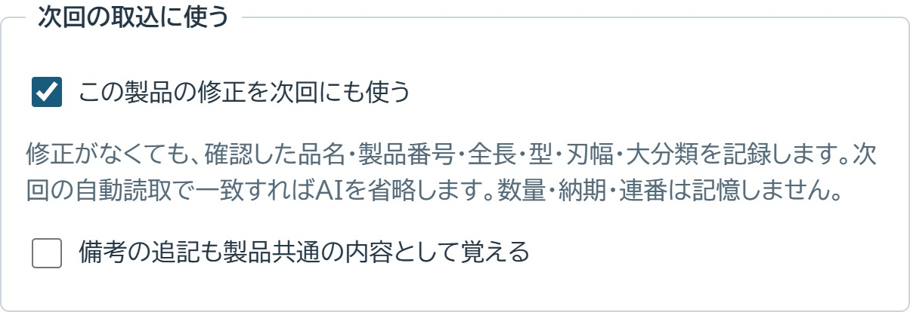

1. **「この製品の修正を次回にも使う」を確認する**
   チェックして案件を確定すると、修正がなくても品名・製品番号・全長・型・刃幅・大分類を記録します。記録は全端末で共有します。

2. **共通の備考を覚える場合だけ追加で選ぶ**
   繰り返し使う追記には「備考の追記も製品共通の内容として覚える」を選びます。今回限りの指示は確認画面の備考だけへ入れます。

3. **不要になった補完を解除する**
   「注文を取り込む」→「覚えた製品の補完」を開き、対象の「この補完を忘れる」を選びます。

**注文ごとに確認する情報**

数量・納期・連番は今回の原本から確認します。製品補完は、得意先と品番・仕様を含む製品の情報が一致したときに使われます。

[注文書や本文を取り込む](#import)　[読取結果を確認して案件へ反映する](#intake)

## 製品ラベルを印刷する

編集者

A4縦に、選んだ順で上から最大9枚を印刷します。1枚は横152 mm・縦32 mmです。

**上部の「ラベル印刷」 → 製品ラベルを印刷**

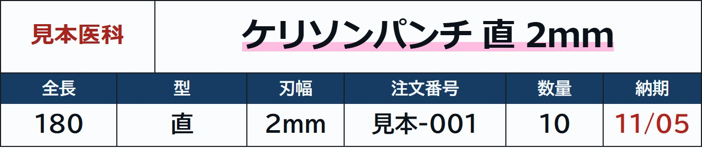

1. **印刷する案件を選ぶ**
   表示範囲と検索で対象を探します。「印刷プレビュー」で得意先・品名・連番・数量・納期・仕様を照合します。

2. **「○枚を印刷」を押す**
   A4縦・倍率100%を選び、ヘッダーとフッターをオフにします。最初の印刷では、紙の寸法を確認してください。

3. **紙で確認してから印刷結果を確定する**
   正しく印刷できたら「印刷完了・待ちから外す」。中止や失敗時は「キャンセル・待ちに残す」を選びます。

**ラベルの読み方**

上段の得意先と品名は1行で、品名に型がないときは型が付きます。下段は全長・型・刃幅・注文番号（連番）・数量・納期です。全長18 cmは「180」で印字します。マーカー色は納期月で変わります。

[読取結果を確認して案件へ反映する](#intake)　[配布担当と配布表を管理する](#distribution)

## 研磨へ発送して戻りを記録する

編集者

対象の連番と現物を照合し、発送した日と戻った日を記録します。

**工程一覧の「研」 → 研磨管理表**

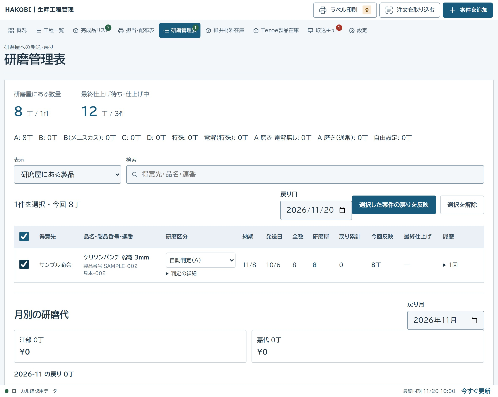

1. **工程一覧で対象の「研」を押す**
   押すと確認画面を経ず、未発送分の全数を当日の発送として記録します。発送日は工程一覧の「発」と研磨管理表で確認します。

2. **全数が戻った案件を選ぶ**
   「研磨管理表」の「研磨屋にある製品」で対象にチェックします。「今回反映」には未返却分の全数が表示されます。

3. **戻り日を指定して反映する**
   「選択した案件の戻りを反映」を押します。最大100件に同じ戻り日を記録し、最終仕上げへ進めます。

**一部だけ戻った場合**

一括操作は選択案件の未返却分すべてを記録します。現物が揃った時点で、この一括操作を行います。

[最終仕上げを完了する](#final-finish)　[研磨の戻りや発送を取り消す](#polishing-correction)

## 研磨の戻りや発送を取り消す

編集者

品名と連番を照合し、訂正する発送・戻りの履歴を開きます。

**研磨管理表 → すべて・履歴 → 対象行の履歴**

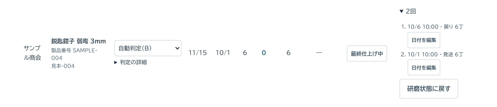

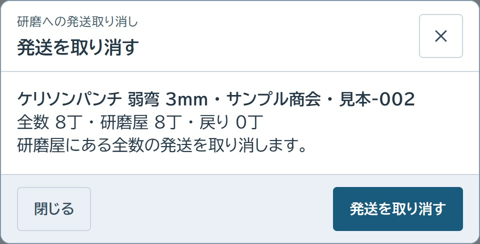

1. **戻りを取り消す**
   「研磨状態に戻す」で戻りの全数量を取り消します。発送日と発送数量は維持され、最終仕上げは未着手へ戻ります。

2. **発送を取り消す**
   「発送を取り消す」を選び、研磨屋にある未返却分の全数量を確認して実行します。

3. **履歴と数量を照合する**
   元の記録と取消記録を確認します。出荷済み案件の数量訂正は、先に完成品リストで再開してください。

**戻り月への反映**

戻り取消は元の戻り月の研磨代へ反映します。日付だけの訂正には「日付を編集」を使います。

[研磨の発送日と戻り日を直す](#polishing-date)　[出荷完了と再開を記録する](#completed)

## 研磨の発送日と戻り日を直す

編集者

「日付を編集」では発送・戻りの実日付を訂正できます。出荷済み案件でも操作できます。

**研磨管理表 → すべて・履歴 → 日付を編集**

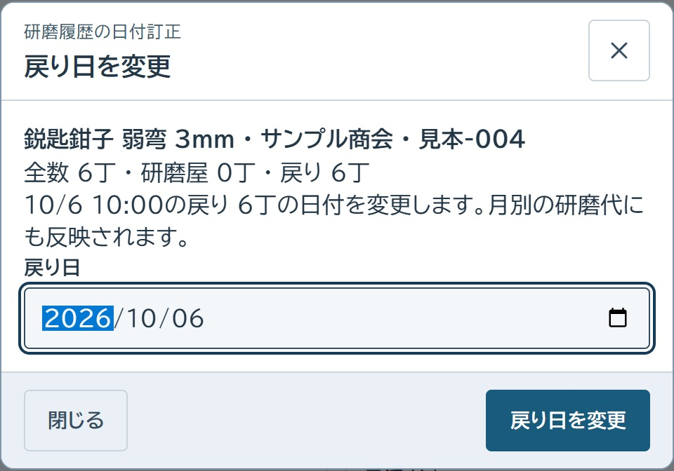

1. **訂正する記録を開く**
   品名と連番を照合し、発送または戻りの履歴から「日付を編集」を押します。

2. **実際の日付を入力する**
   今日以前の日付を指定します。戻り日が発送日以降になっているかも確認します。

3. **「発送日を変更」か「戻り日を変更」を押す**
   履歴に反映された日付を確認します。戻り日が別の月なら、研磨代もその月へ移ります。

**数量も訂正が必要な場合**

発送・戻りの数量は、対象の履歴から取消操作を使って訂正します。

[研磨の戻りや発送を取り消す](#polishing-correction)　[月別の研磨代を確認する](#billing)

## 研磨区分と自由設定単価を選ぶ

編集者

依頼先と製品の仕様を確かめて、研磨区分と必要な単価を設定します。

**研磨管理表 → 対象製品の研磨区分**

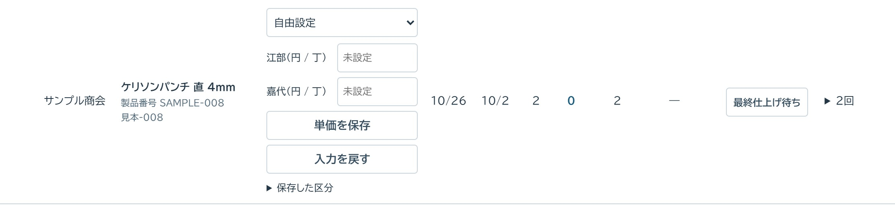

1. **区分と「判定の詳細」を確認する**
   メニスカスの区分は「B(メニスカス)」です。手動指定を解除する場合は自動判定を選びます。

2. **必要な製品の区分を変更する**
   江部向けは「電解(特殊)」「A 磨き 電解無し」「A 磨き(通常)」を確認します。変更は同じ製品と月別集計に反映されます。

3. **自由設定では円／丁を保存する**
   「自由設定」を選び、江部・嘉代それぞれの単価を入れて「単価を保存」を押します。編集をやめる場合は「入力を戻す」を押します。

**未確定の金額**

区分・単価が不足している案件を確認します。単価を実際の依頼内容と照合してください。

[月別の研磨代を確認する](#billing)

## 月別の研磨代を確認する

編集者

集計する月を選ぶと、その月に戻りを記録した分の研磨代を確認できます。

**研磨管理表 → 月別の研磨代**

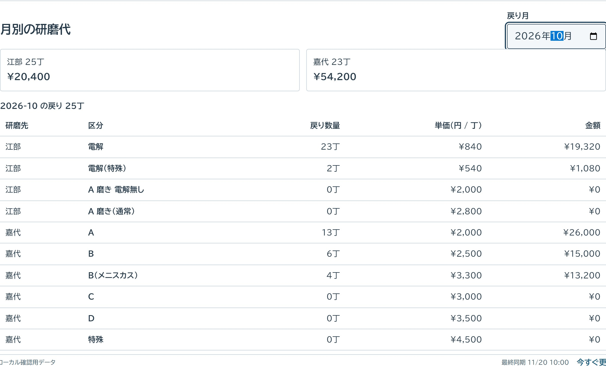

1. **集計する戻り月を選ぶ**
   「戻り月」で対象月を指定し、江部と嘉代の数量・金額を照合します。戻り取消や日付の訂正があれば、元の戻り月も確認します。

2. **区分と金額を確認する**
   未分類や未確定の製品があれば、対象行で研磨区分を確認します。自由設定の単価は製品ごとに確認できます。

[研磨区分と自由設定単価を選ぶ](#polishing-class)　[研磨の発送日と戻り日を直す](#polishing-date)

## 出荷完了と再開を記録する

編集者

出荷の記録は、完成品リストの上段「出荷待ち」から行います。下段「出荷済み」から出荷待ちへ戻せます。

**完成品リスト → 出荷待ち または 出荷済み**

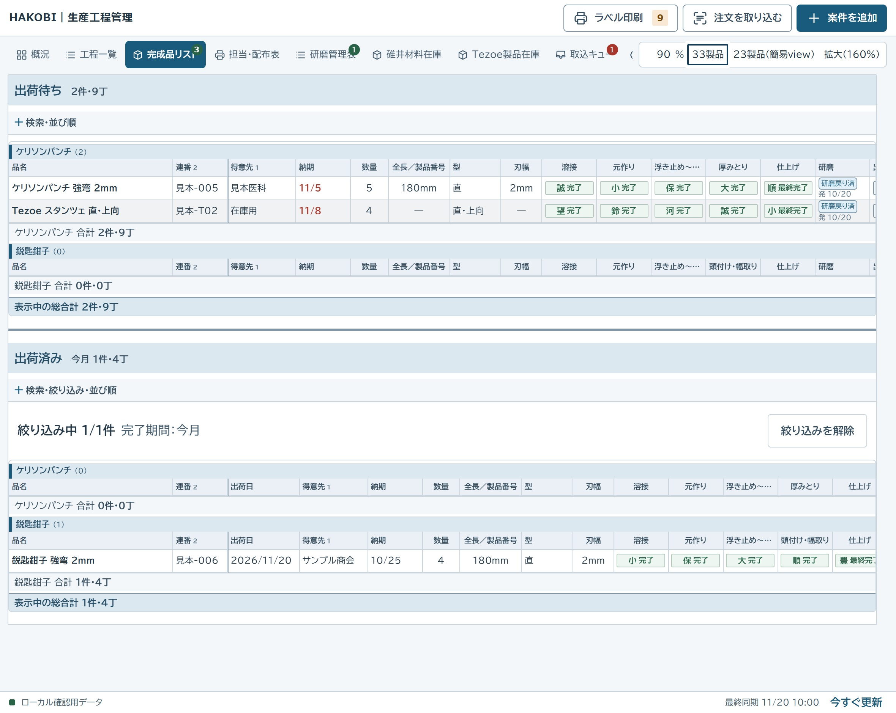

1. **出荷待ちで対象を確認する**
   最終仕上げが終わった対象の得意先・品名・連番・数量を照合します。

2. **実際の出荷後に出荷完了を記録する**
   対象行の「出荷する」を押し、「出荷完了・終了へ」を選びます。Tezoeで予定した在庫分は、先に在庫画面で実出荷を記録します。

3. **出荷済みを訂正するときは再開する**
   対象の出荷記録を開き「出荷待ちへ戻す」を押します。研磨の戻り数量を直す場合も、先に出荷待ちへ戻します。

**製造がないTezoe受注**

全数を既存在庫で納め、製造総数が0の受注は、Tezoe製品在庫の受注行から「受注履行完了」を記録します。

[在庫から実際の出荷を記録する](#stock-ship)　[全数を在庫で納める受注を完了する](#stock-only)

## 材料の在庫を確認して発注する

編集者

「在庫一覧」で現在庫・発注残・次回入庫予定を確認します。本体とカブセで1セットです。

**碓井材料在庫 → 材料を発注**

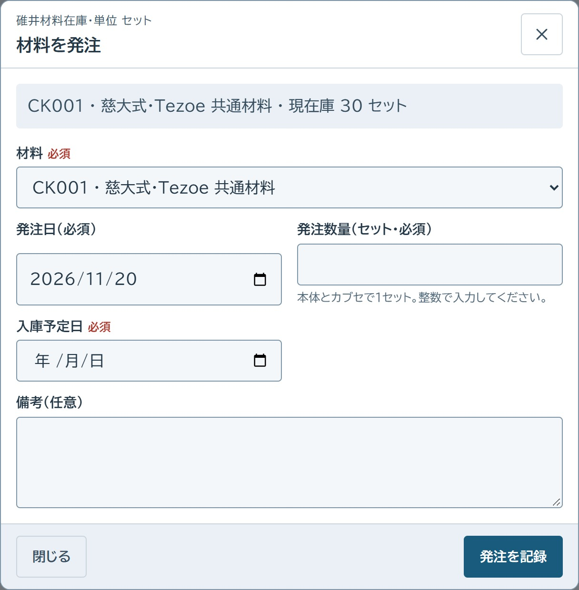

1. **対象材料と残数を確かめる**
   材料・品番と型を確認します。「材料の確認が必要です」に出た案件は、製品番号と仕様を原本で照合します。

2. **「材料を発注」を開く**
   材料、発注日、発注数量（セット）、入庫予定日を入力します。必要な備考を添えます。

3. **「発注を記録」を押す**
   「発注・入庫一覧」で発注残を確認します。現物が届いたら、発注行から入庫を記録します。

**注文確定時の材料引当**

対象製品は1丁につき1セットを自動で引き当てます。慈大式とTezoeは一部の材料を共用し、Tezoe 26002は専用材料を使います。

[材料の入庫・発注の変更を記録する](#material-receive)　[碓井材料を使わない製品を登録する](#material-exclusions)

## 材料の入庫・発注の変更を記録する

編集者

発注ごとに入庫と発注残を確認できます。分納の場合は、同じ行に入庫日と数量が積み上がります。

**碓井材料在庫 → 発注・入庫一覧 → 対象の発注行**

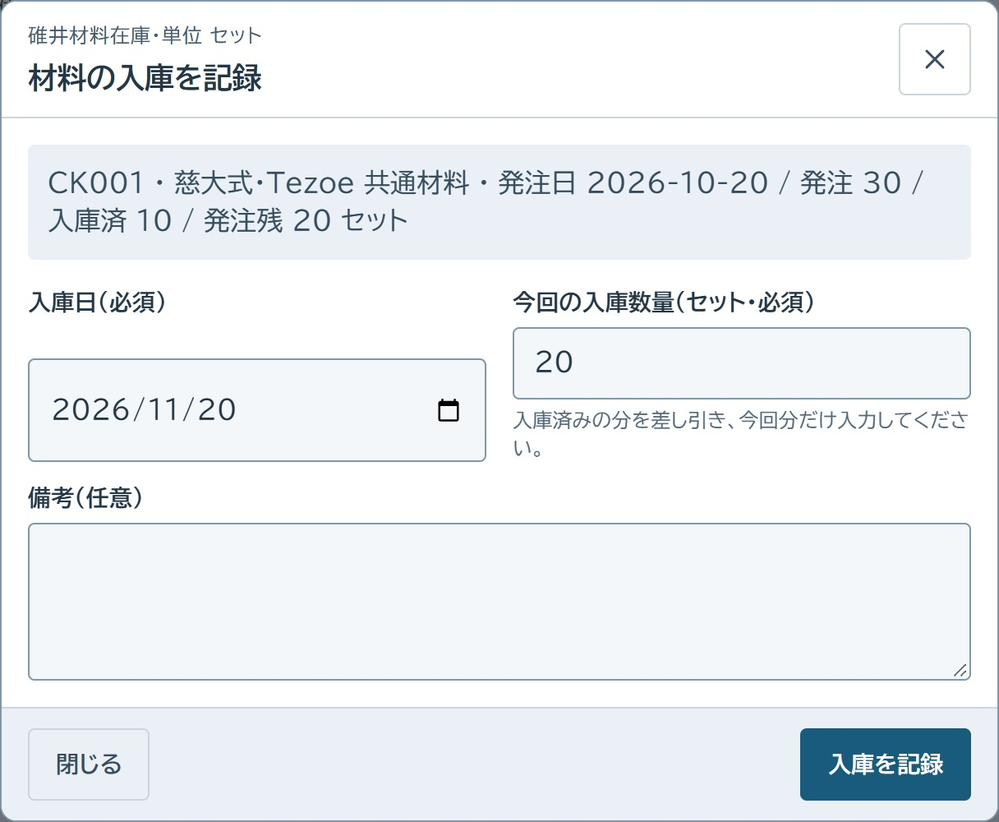

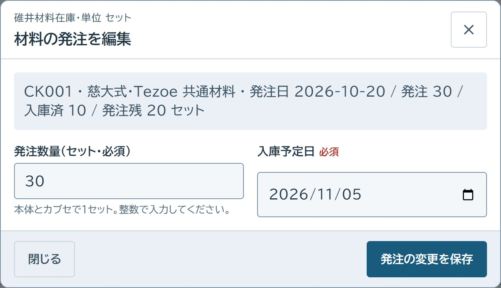

1. **届いた材料の発注行を開く**
   「入庫を記録」を押し、材料と発注を確認します。完納後に同じ発注で届いた分は「追加で入庫」を使います。

2. **今回届いた全数と実際の入庫日を入れる**
   「入庫を記録」を押します。発注を超えた分も実数で記録でき、発注残は0、超過分は「発注超過 ○ セット」と表示されます。

3. **発注内容の訂正は「発注を編集」を開く**
   発注数量と入庫予定日を修正し、「発注の変更を保存」を押します。発注日は元の日付が表示されます。

4. **届かない残数を取り消す**
   「残数を取消」で取消日と理由を記録します。今回取り消すのは未入庫分の全量です。

**すでに記録した入庫数を直すとき**

現物との差を「在庫調整」で直し、調整理由に元の入庫を記載します。

[材料の在庫を確認して発注する](#materials)　[材料の棚卸差と備考を記録する](#material-adjust)

## 材料の棚卸差と備考を記録する

編集者

現物との差は「在庫調整」、保管場所などの連絡事項は在庫一覧の「備考」へ記録します。

**碓井材料在庫 → 在庫一覧 → 対象材料**

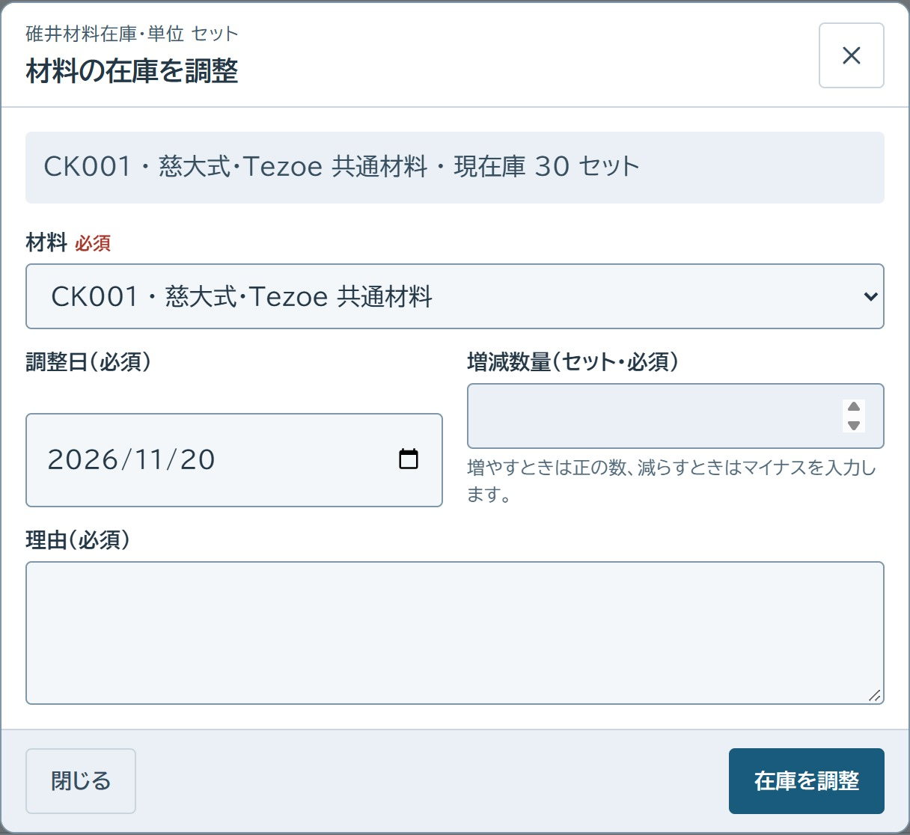

1. **「在庫調整」を押す**
   対象材料と現在庫を確認し、調整日を選びます。

2. **増減するセット数を入れる**
   5セット戻すなら「5」、2セット足りないなら「-2」を入れます。

3. **理由を入れて「在庫を調整」を押す**
   保存後に現在庫と「入出庫・発注の履歴」を確認します。

4. **備考欄に入力して横の「保存」を押す**
   一覧右端の「備考」欄を使います。別端末の更新が出たら入力を控え、「最新の備考を表示」で確認します。

**案件を完了・削除した後の材料**

実物を在庫に戻した場合は「在庫調整」で加算し、理由に対象案件を残します。

[材料の入庫・発注の変更を記録する](#material-receive)　[碓井材料を使わない製品を登録する](#material-exclusions)

## 碓井材料を使わない製品を登録する

編集者

確認欄に出た製品について、碓井材料を使わないことが確認できた場合に登録します。

**碓井材料在庫 → 材料の確認が必要です**

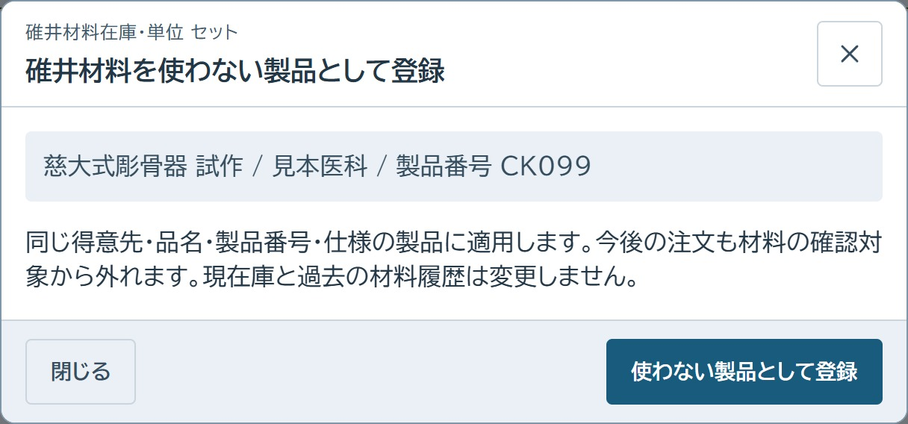

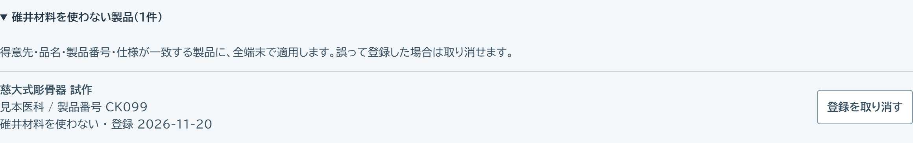

1. **対象の品番と仕様を確認する**
   「材料の確認が必要です」の対象行で得意先・品名・製品番号・仕様を原本と照合します。注文の入力違いなら「注文を確認・修正」を使います。

2. **「碓井材料を使わない」を押す**
   画面で対象製品と適用範囲を確認し、「使わない製品として登録」を押します。

3. **登録した製品を確認する**
   「碓井材料を使わない製品」を開きます。誤登録は対象の「登録を取り消す」から戻します。

**適用の範囲**

得意先・品名・製品番号・全長・型・刃幅が一致する今後の注文にも適用します。材料の引当が残る場合は、先にその案件の内容と材料使用を確認します。

[材料の在庫を確認して発注する](#materials)　[材料の棚卸差と備考を記録する](#material-adjust)

## Tezoe製品の在庫と見込を読む

編集者

完成品の実在庫・受注に確保済みの数・将来の見込を、製品ごとに丁数で確認できます。

**Tezoe製品在庫 → 種類ごとの在庫と見込**

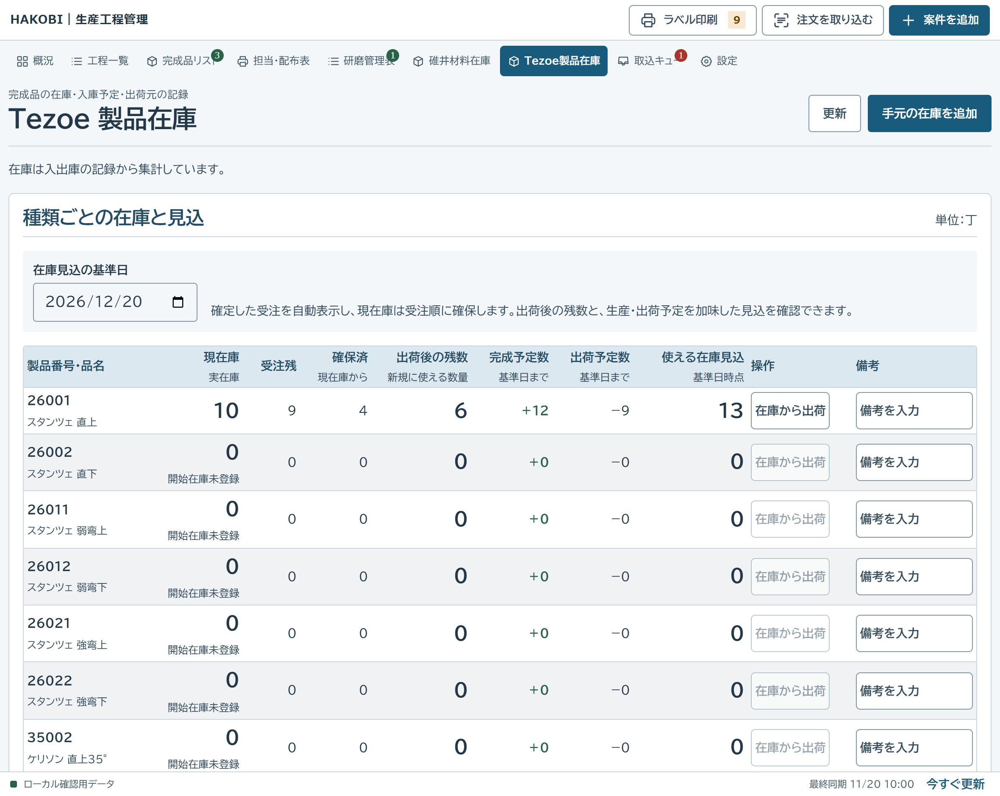

1. **今使える数量を確認する**
   「現在庫」は現物の数です。受注に確保した分を除いた「出荷後の残数」が、新しい注文に使える数量です。

2. **「在庫見込の基準日」を指定する**
   基準日までの完成・出荷予定と、後日の受注確保分を反映した「使える在庫見込」を確認します。負数は不足です。

3. **確認が必要な受注の注文内容を直す**
   「在庫への反映に確認が必要な受注」が出たら、製品番号・品名・仕様・数量を照合します。有効な受注が確認対象です。

**予定を現物へ反映する操作**

現物が増減したら入庫・出荷を記録します。出荷日未定の受注も見込から差し引き、完成日未定の生産は完成予定数に含めません。

[Tezoe製品の備考を編集する](#stock-note)　[受注の出荷予定を決める](#stock-schedule)

## Tezoe製品の備考を編集する

編集者

棚の場所や出荷時の注意を、製品ごとの備考に記録して全端末で共有できます。

**Tezoe製品在庫 → 種類ごとの在庫と見込 → 備考**

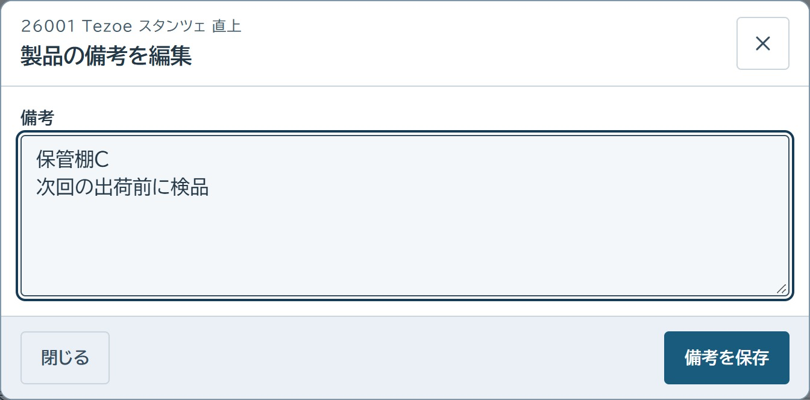

1. **対象行の備考を開く**
   右端で「備考を入力」か、すでに表示されている備考を押します。

2. **備考を入力する**
   「製品の備考を編集」で品番・品名を確認し、連絡事項を入力します。備考を消すときは空欄にします。

3. **「備考を保存」を押す**
   一覧に内容が表示されたことを確認します。

**別の端末で更新された場合**

入力を控え、画面を更新して備考を開き直します。新しい内容を確認してから保存してください。

[Tezoe製品の在庫と見込を読む](#stock-overview)　[Tezoeの新製品・特注品を在庫に追加する](#stock-custom)

## Tezoeの新製品・特注品を在庫に追加する

編集者

案件に保存した品名・製品番号・全長・型・刃幅から、在庫の製品候補が作られます。

**注文情報を保存 → Tezoe製品在庫 → 手元の在庫を追加**

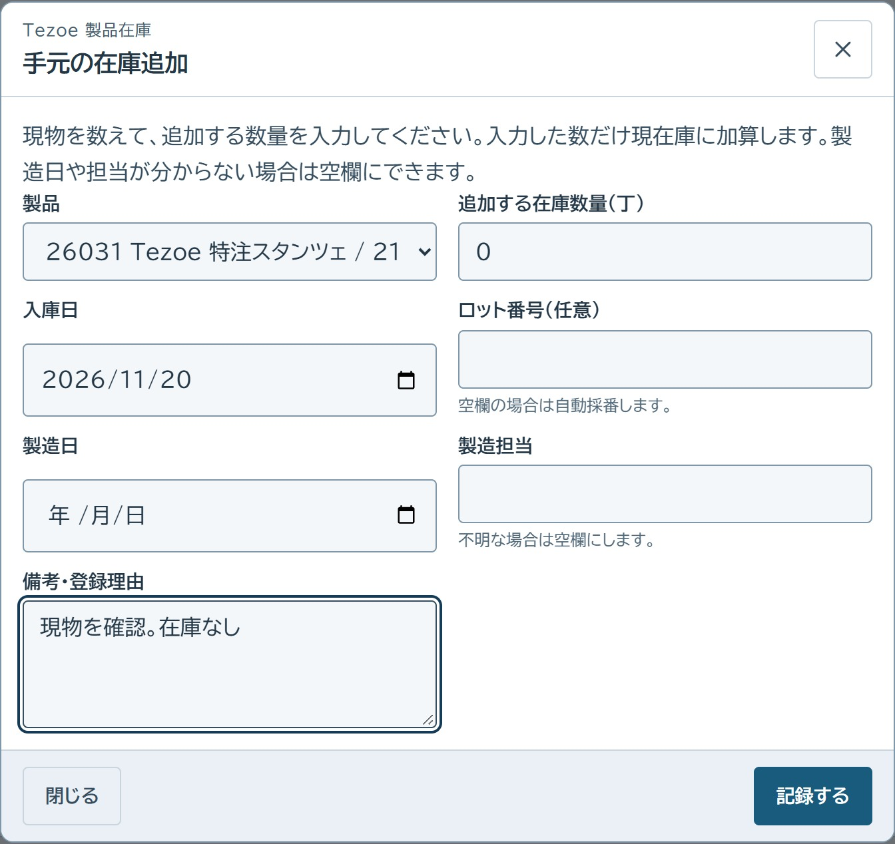

1. **保存する前に品名・品番・仕様を照合する**
   品名に「Tezoe」を含め、全長・型・刃幅を確認します。製品番号がある場合は原本と照合し、注文を保存します。

2. **「手元の在庫を追加」で製品を選ぶ**
   「製品」の選択肢から、該当する品名・製品番号・仕様を確認して選びます。

3. **現物の数量を入れて記録する**
   実際の数量と入庫日、登録理由を入力し、「記録する」を押します。現物が0丁でも記録できます。

4. **種類ごとの在庫と見込で確認する**
   在庫を記録した製品や、在庫補充の予定を入力した製品が一覧に表示されます。

**初回登録時の照合**

品名に含まれる番号も、入力した製品番号と照合します。品番・寸法・向きの異なる製品は、実際の製品ごとに正確に登録してください。

[Tezoe製品の在庫と見込を読む](#stock-overview)　[完成品をロットで入庫する](#stock-receive)

## 受注の出荷予定を決める

編集者

先に実際の注文数量と在庫から出す分を保存します。その後に製造数を決めます。

**Tezoe製品在庫 → 受注と出荷予定 → 出荷予定**

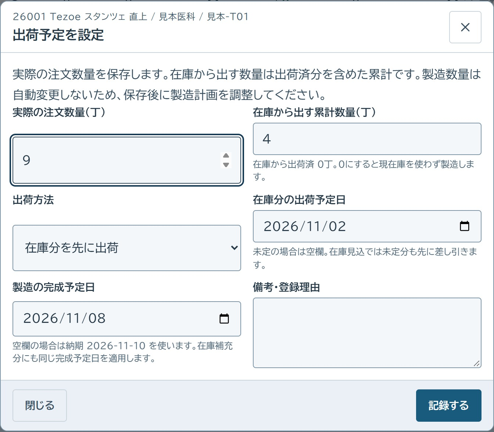

1. **注文数量と在庫から出す数量を入力する**
   「在庫から出す累計数量」には出荷済みの数量も含めます。在庫を使わず全数製造する場合は0を入れます。

2. **出荷方法と日付を選ぶ**
   「在庫分を先に出荷」か「不足分の完成後に一緒に出荷」を選びます。出荷日が未定なら空欄で保存できます。完成予定日が空欄なら納期を使います。

3. **「記録する」を押し、製造計画へ進む**
   注文数を保存した後、「製造計画」で不足分と在庫補充分を合わせた製造総数を入力します。

**一緒に出荷する場合**

不足分の最終仕上げが終わり、研磨に出した全数が戻ってから、在庫分の実出荷を記録します。

[製造総数と在庫補充分を入力する](#stock-plan)　[在庫から実際の出荷を記録する](#stock-ship)

## 製造総数と在庫補充分を入力する

編集者

注文情報の「数量」は製造総数です。「うち在庫予定（Tezoe）」には、その中で補充に回す数量を入力します。

**Tezoe製品在庫 → 受注と出荷予定 → 製造計画**

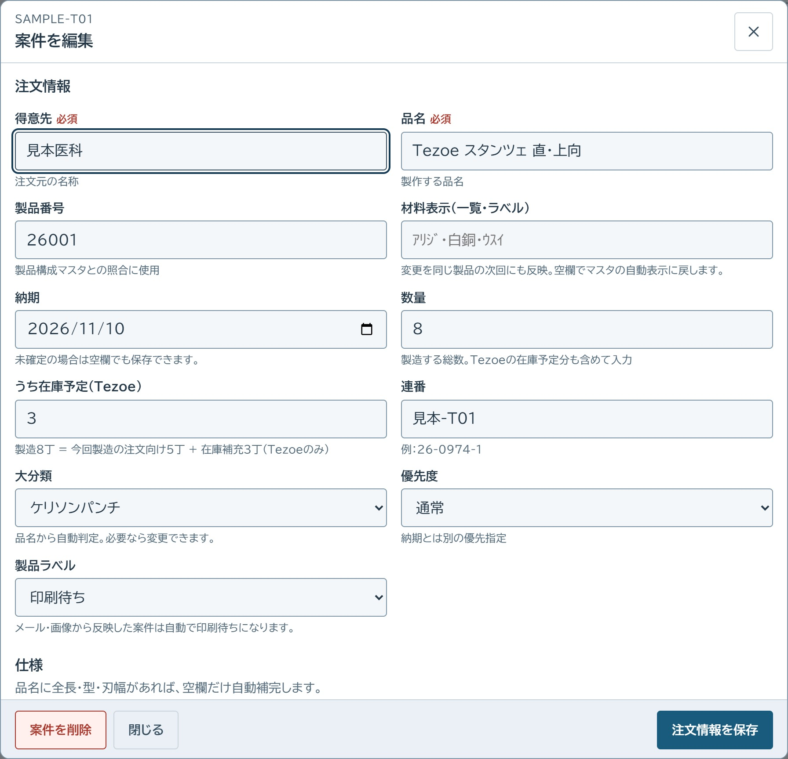

1. **受注分の不足数と補充数を決める**
   注文9丁のうち既存在庫から4丁を出すなら、新たに作る受注分は5丁です。補充を3丁作る場合は、合計で8丁を製造します。

2. **「製造計画」で数量と内訳を入力する**
   先に「出荷予定」で注文数量を確定し、例では「数量」8、「うち在庫予定（Tezoe）」3と入力して保存します。

3. **「完成予定と在庫補充」を確認する**
   製造総数・注文向け製造・在庫予定分・在庫追加残を見ます。「完成予定」で日付を設定できます。

**在庫用の製造**

得意先が「在庫」または「在庫用」なら、全数を在庫補充として扱います。既存在庫のみで納める顧客受注は、製造総数を0にします。

[受注の出荷予定を決める](#stock-schedule)　[全数を在庫で納める受注を完了する](#stock-only)

## 完成品をロットで入庫する

編集者

製造した在庫補充分は、研磨の全数戻りと最終仕上げの完了後に入庫します。

**Tezoe製品在庫 → 完成予定と在庫補充 → 在庫分を入庫**

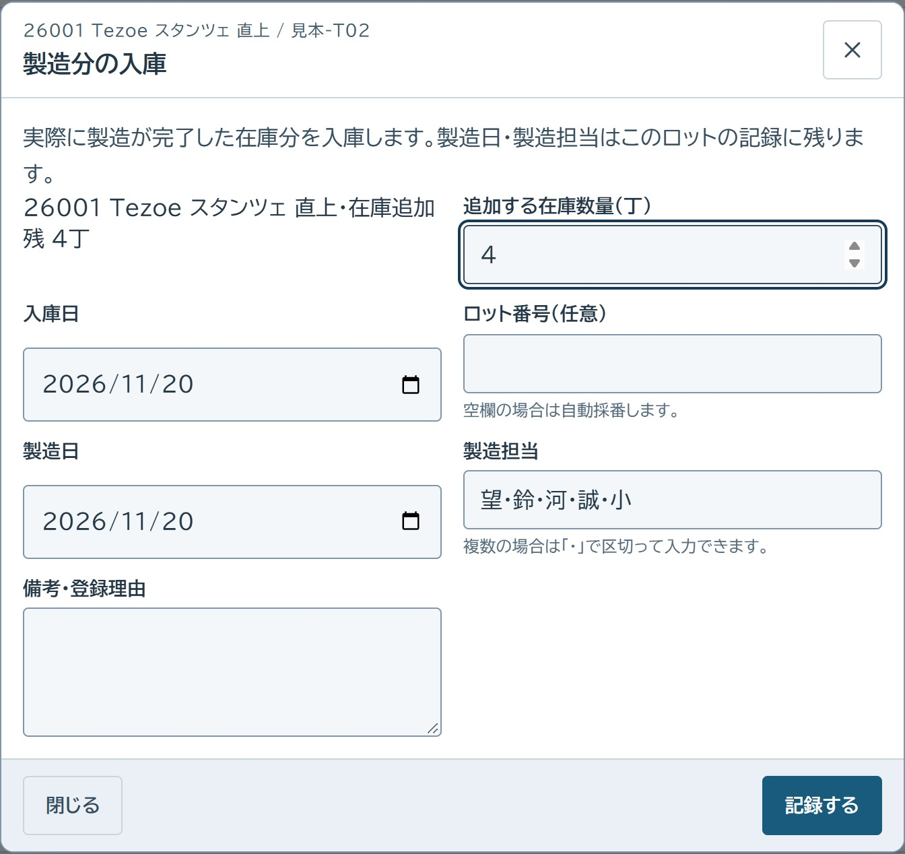

1. **該当行の「在庫分を入庫」を押す**
   実際に入庫する数量と入庫日を入れます。在庫追加残の範囲で、複数回に分けて記録できます。

2. **製造日と製造担当を入力する**
   製造担当が複数なら「・」で区切ります。ロット番号は任意で、空欄の場合は自動採番します。

3. **入庫とロットを確認する**
   記録後は「製造ロットから在庫を確認」で入庫数・残数・製造日・担当を照合します。

**手元にある在庫の初回登録**

「手元の在庫を追加」では入力した数量が現在庫に加算されます。現物を数え、登録済みの分と重複がないか先に確かめます。

[Tezoeの新製品・特注品を在庫に追加する](#stock-custom)　[製品在庫の記録を取り消す](#stock-reverse)

## 在庫から実際の出荷を記録する

編集者

実際に出した在庫分を、対象の受注とロットに紐付けて記録します。

**Tezoe製品在庫 → 受注と出荷予定 → この受注へ出荷**

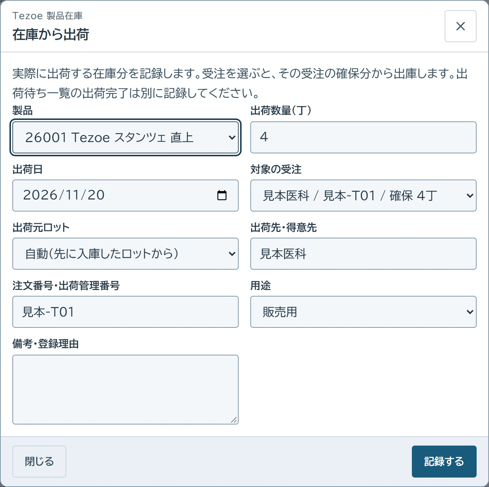

1. **出荷する受注と数量を照合する**
   出荷先・連番・実際の出荷日・出荷数量・用途を確認します。受注に紐付けない出荷は、未確保の在庫を使います。

2. **出荷元ロットを指定して記録する**
   「自動」は先に入庫したロットから使います。特定のロットから出す場合は「このロットから出荷」を選びます。

3. **注文向けの製造分も出したら完了を記録する**
   実際に出した在庫分を記録し、製造分まで出荷した時点で完成品リストの「出荷待ち」から出荷完了を記録します。

**製造と在庫を合わせて納める例**

注文5丁を製造3丁と在庫2丁で納める場合、在庫2丁の実出荷を記録した後で、案件の出荷完了を記録できます。

[出荷完了と再開を記録する](#completed)　[全数を在庫で納める受注を完了する](#stock-only)

## 全数を在庫で納める受注を完了する

編集者

全数を既存在庫から納め、製造総数が0の顧客受注は「受注履行完了」を使います。

**Tezoe製品在庫 → 受注と出荷予定**

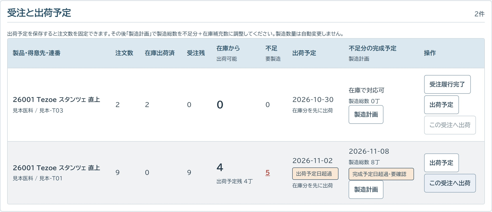

1. **先に注文数と在庫出荷の予定を保存する**
   注文2丁をすべて在庫から出す場合、注文数量2・在庫から出す累計数量2を保存し、製造計画の数量を0にします。

2. **「この受注へ出荷」から全数を記録する**
   対象の受注に紐付け、出荷日と実際の出荷数量を記録します。

3. **「受注履行完了」を押す**
   全数が揃うと対象の受注に表示されます。最後の有効な出荷日を完了日として、完成品リストの出荷済みに移ります。

**出荷取消後の受注**

取消で受注残が戻ると、この受注は自動で再開します。製造分がある注文の出荷完了は完成品リストで記録します。

[受注の出荷予定を決める](#stock-schedule)　[製品在庫の記録を取り消す](#stock-reverse)

## 製品在庫の記録を取り消す

編集者

誤った入庫や出荷を、元の記録が残る形で取り消します。

**Tezoe製品在庫 → 入出庫と出荷元の履歴 → 訂正のため取り消す**

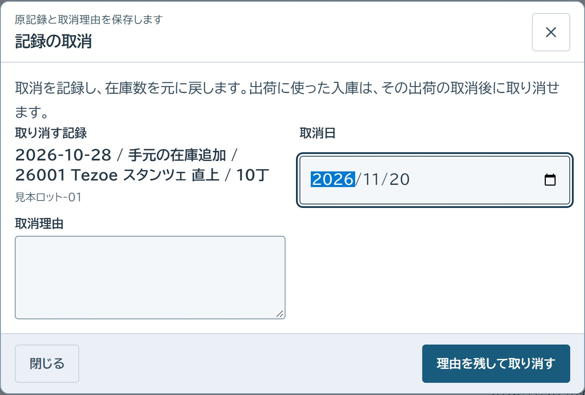

1. **対象の記録を照合する**
   日付・製品・数量・ロット・受注を確認します。

2. **在庫や受注の状態を先に確認する**
   出荷に使ったロットの入庫を取り消す場合は、関連する出荷を先に取り消します。製造分を含む出荷済み受注は、完成品リストで先に再開します。

3. **取消日と理由を入力して記録する**
   取消の履歴、在庫の増減、受注残を確認します。在庫のみの受注は残数復帰に合わせて再開します。

**通信で結果が分からない場合**

「前回の記録を確認する」または「更新」で履歴と残数を照合します。再試行は保持された入力を使います。

[在庫から実際の出荷を記録する](#stock-ship)　[保存失敗と未保存入力に対応する](#errors)

## 困ったときの確認と終業時の点検

作業者・編集者

問題が起きたら、品名・連番・操作した時刻・画面の文言を控えます。

- **案件が見つからない**  検索・工程・状況・期間の条件を確認します。最終仕上げが完了した案件は完成品リストで確認できます。

- **最終仕上げを完了できない**  研磨へ実数量の全数を発送し、全数戻りが記録されているか確認します。

- **保存に失敗した**  「入力内容を開く」から復元します。編集者は在庫記録の結果が不明なとき、再試行前に履歴を照合します。

- **出荷を完了できない（編集者）**  Tezoe製品在庫で受注の出荷予定残、実出荷、製造計画を照合します。

- **在庫数が合わない（編集者）**  材料はセット数、製品は丁数を確認します。現物を数え、調整や取消の前に履歴を照合します。

- **印刷が小さい・ずれる**  配布表・製品ラベルはA4縦・倍率100%にし、ヘッダーとフッターをオフにします。製品ラベルを印刷する編集者は1枚152 mm×32 mmを確認します。

- **必要なボタンが見つからない**  登録したGoogleアカウントで開き、権限を確認します。

**退勤前の点検**

共通で当日の工程担当と状態、保存結果を確認します。編集者は研磨の現物と履歴、実際の出荷、確認待ちの取込も点検します。

[作業者と編集者が使う画面](#roles)　[保存失敗と未保存入力に対応する](#errors)
